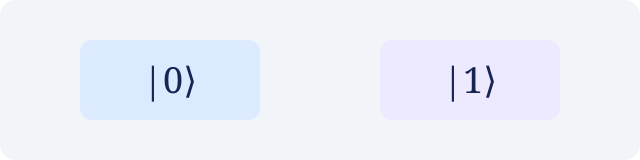

이 글은 작성 방법을 확인하기 위한 **초안**입니다. 공개하려면 위 설정에서 `draft: true`를 삭제하세요.

## 수식으로 표현하기

큐비트의 순수 상태는 다음과 같이 쓸 수 있습니다.

$$
|\psi\rangle = \alpha |0\rangle + \beta |1\rangle,
\qquad |\alpha|^2 + |\beta|^2 = 1.
$$

계산 기저로 측정하면 $0$이 나올 확률은 $|\alpha|^2$, $1$이 나올 확률은 $|\beta|^2$입니다.

## 그림 넣기

아래는 두 계산 기저 상태의 간단한 도식입니다. 두 상자 사이의 공간은 물리적 거리나 상태 공간을 나타내지 않습니다.

직접 그린 그림도 이 폴더에 저장하고 같은 방식으로 넣을 수 있습니다.
